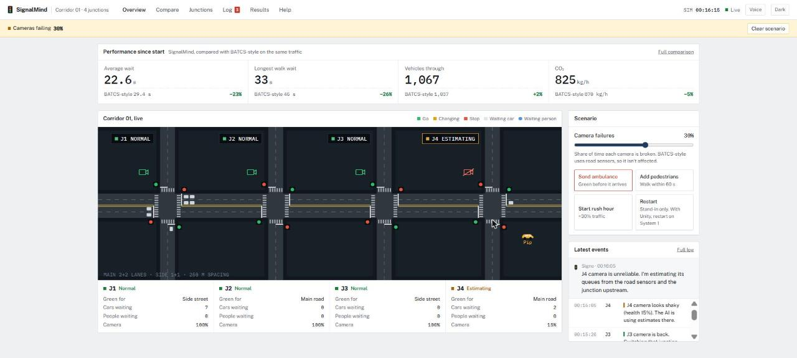
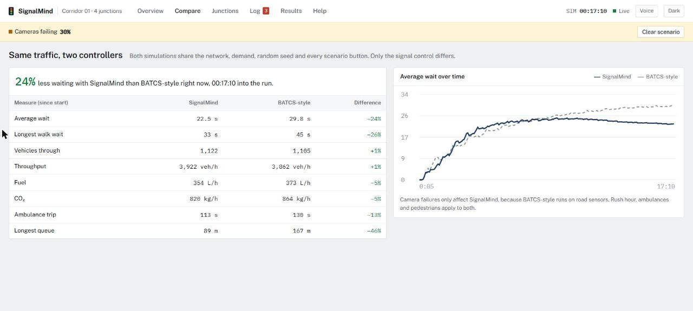
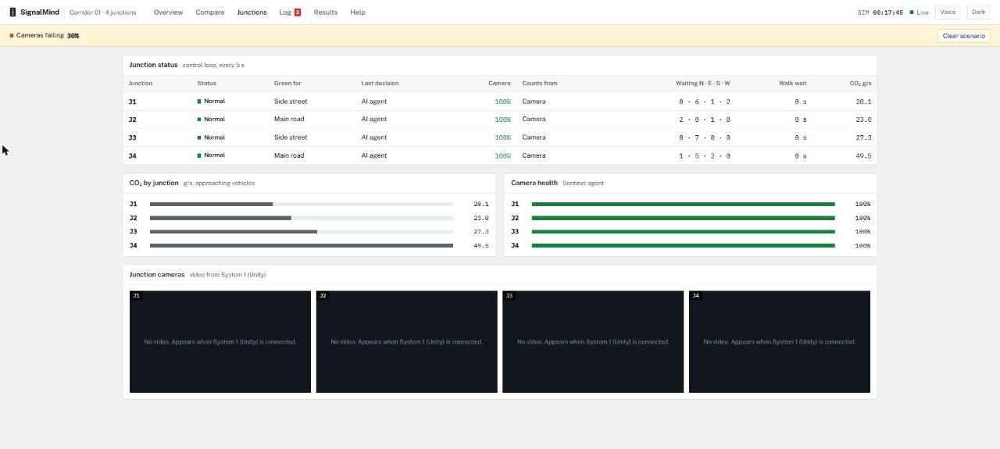
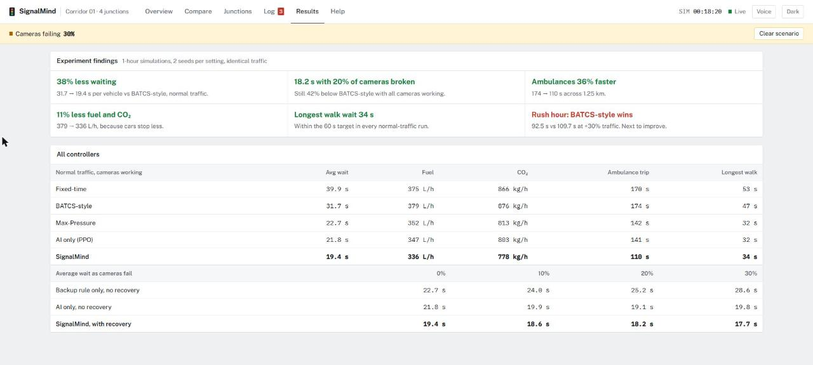
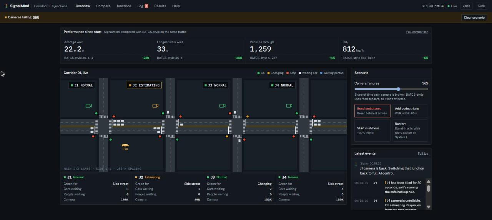

# SignalMind

**A team of AI agents that runs the traffic signals of a four-junction, Bengaluru-style corridor inside a SUMO + Unity digital twin.** The agents coordinate with each other, clear the way for ambulances, keep pedestrians under a 60-second wait, track fuel and CO₂, and keep working when their cameras fail.

CodeSpark 2026 · Domain 3 · Problem statement 1 · This repository is **System 2**: the decision agents, the live control loop and the operator dashboard. System 1 (Unity, the SUMO bridge and camera perception) runs on a separate GPU machine and talks to this one through Redis.



## Results

Simulation results: 1-hour episodes, 2 seeds per setting, identical traffic for every controller, ambulances and pedestrians in every run. The "BATCS-style" baseline is our stand-in for Bengaluru's adaptive signals (actuated timing with green-wave offsets). The real system's algorithm (CoSiCoSt) isn't public, so we don't claim to beat the real BATCS.

| Normal traffic, cameras working | Average wait | Fuel | CO₂ | Ambulance trip | Longest walk wait |
|---|---|---|---|---|---|
| Fixed-time | 39.9 s | 375 L/h | 866 kg/h | 170 s | 53 s |
| BATCS-style | 31.7 s | 379 L/h | 876 kg/h | 174 s | 47 s |
| Max-Pressure | 22.7 s | 352 L/h | 813 kg/h | 142 s | 32 s |
| AI only (PPO) | 21.8 s | 347 L/h | 803 kg/h | 141 s | 32 s |
| **SignalMind** | **19.5 s** | **336 L/h** | **778 kg/h** | **110 s** | **34 s** |

- **38% less waiting** than BATCS-style, and **18.2 s with 20% of cameras broken**.
- **Ambulances 36% faster** across the 1.25 km corridor.
- **11% less fuel and CO₂.**
- **0 transitions without amber** in all 56 episodes.
- **Where we lose:** at rush hour (+30% traffic) BATCS-style wins, 92.5 s vs our 109.7 s. The corridor is beyond capacity there and every controller gridlocks. This is the next thing to improve.

Charts are in [`experiments/results/`](experiments/results), and the full table is in [`summary.md`](experiments/results/summary.md).

## Dashboard

The operator console at `http://localhost:8000` has six views.

**Compare.** A second, headless simulation runs the BATCS-style controller on exactly the same traffic (same network, demand, seed and scenario buttons), so the comparison happens live in front of the judges.



**Junctions.** Each junction's mode, current green, who made the last decision, camera health, the data source in use, and queues per approach. It also shows CO₂ per junction and the camera feeds from System 1.



**Results.** The experiment findings in plain sentences, including the one where we lose, plus the full comparison tables.



**Dark theme**, for control rooms and projectors. It follows the system setting and can be switched in the header.



On the Overview, the **scenario controls** let anyone break cameras (0–50%), send an ambulance, add pedestrians or start rush hour, then watch the agents respond. **Signo**, the traffic-light narrator, explains each event in the log, and can read events aloud with the Voice button. **Pip**, the small yellow car on the map, moves to wherever the latest event happened.

## How it decides

Every 5 seconds of simulation time, a LangGraph supervisor runs `sense → recover → decide → act → publish`. Decisions follow a fixed priority:

1. **Safety rules always win.** Amber 3 s, then all-red 2 s, minimum green 10 s, maximum green 60 s. Amber is never skipped.
2. **Ambulances.** The Emergency agent predicts arrival time and turns lights green about 15 s before the ambulance arrives.
3. **Pedestrians.** After 45 s of waiting the walk signal is next, so nobody waits more than 60 s.
4. **Rush hour.** When main-road queues stay high, the Coordinator runs a green wave along the corridor.
5. **Blind camera.** After 30 s without a usable camera, a junction switches to a Max-Pressure backup rule.
6. **Otherwise the AI decides.** Four PPO junction agents share one policy, and the Coordinator overrides obvious mistakes, such as giving green to an empty road.

When a camera is unreliable, the **Recovery agent** (one Kalman filter per approach) estimates queues from road sensors and the junction upstream.

## Architecture

```
SYSTEM 1 (high GPU)                                REDIS                SYSTEM 2 (this repo)
Unity 3D twin + SUMO + bridge + YOLO   ── gt.* perc.* kpi frame.* event ──►   orchestrator/live.py (LangGraph)
  (or twin/system1_standin.py)         ◄── act.* fault.cfg ctl ─────────────  server/app.py + dashboard
                                                                              twin/shadow_baseline.py → kpi.batcs
```

| Part | File |
|---|---|
| Message definitions shared with System 1 (also accepts System 1's field names) | `bus.py` |
| Corridor network: Bengaluru traffic mix (40% two-wheelers, autos, buses), pedestrians, ambulances | `twin/build_net.py` → `twin/net/` |
| Simulation core, safety shield, KPI meter | `twin/sim.py` |
| Headless System 1 stand-in (testing, and the demo fallback) | `twin/system1_standin.py` |
| BATCS-style shadow run for the live comparison | `twin/shadow_baseline.py` |
| Camera fault injector (frames and counts) | `perception/faults.py` |
| Recovery agent (Kalman + upstream + road sensors) | `recovery/kalman.py` |
| PPO junction agents: environment, trainer, policy | `agents/junction/` |
| Brain: modes, Emergency, Pedestrian, Coordinator, green wave, arbiter | `orchestrator/brain.py` |
| LangGraph supervisor, live loop, Signo narrator | `orchestrator/graph.py`, `live.py`, `narrator.py` |
| Dashboard (FastAPI + WebSocket, one HTML page, no build step) | `server/app.py`, `dashboard/index.html` |
| Baselines, experiment grid, charts | `experiments/` |
| Trained policy (Train A: no faults; Train B: 10–30% camera faults) | `checkpoints/ppo_B.pt` |

## Quick start

Requires Windows or Linux, Python 3.12 and a Redis server both systems can reach. SUMO is installed from pip (`eclipse-sumo`), so there's nothing else to install.

```powershell
uv venv --python 3.12 .venv
uv pip install --python .venv\Scripts\python.exe redis python-dotenv pydantic eclipse-sumo libsumo traci sumolib numpy pandas matplotlib filterpy fastapi "uvicorn[standard]" langgraph anthropic
uv pip install --python .venv\Scripts\python.exe torch --index-url https://download.pytorch.org/whl/cpu
copy .env.example .env        # set REDIS_HOST and REDIS_PASSWORD
.venv\Scripts\python.exe twin\build_net.py
.venv\Scripts\python.exe scripts\check_link.py
```

| What | Command |
|---|---|
| Live loop (takes 30–90 s to start while PyTorch loads) | `.venv\Scripts\python.exe orchestrator\live.py` |
| Dashboard | `.venv\Scripts\python.exe -m uvicorn server.app:app --host 0.0.0.0 --port 8000`, then open http://localhost:8000 |
| Live BATCS-style comparison | `.venv\Scripts\python.exe twin\shadow_baseline.py` |
| Stand-in for System 1 (only when System 1's bridge is **not** running) | `.venv\Scripts\python.exe twin\system1_standin.py --speed 2` |
| Live loop, dashboard and (optionally) stand-in in one go | `powershell -ExecutionPolicy Bypass -File scripts\start_system2.ps1 [-Standin]` |
| Train the junction agents (about 1 hour on 10 CPU cores) | `.venv\Scripts\python.exe agents\junction\train.py --iters 120 --a-iters 40 --workers 10` |
| Experiment grid, then charts | `.venv\Scripts\python.exe experiments\run_grid.py` then `experiments\charts.py` |

**Settings in `.env`:**

- **`SIGNALMIND_OBSERVE=1`** puts the live loop in observe-only mode: it reads System 1, decides, and shows everything on the dashboard, but never writes `act.*`. The dashboard says so clearly. Use it while a new System 1 build is being checked.
- **`ANTHROPIC_API_KEY`** lets Signo phrase events with Claude. Without it, Signo uses built-in sentences, so the demo never depends on the network.

## Working with System 1

Agreed protocol (details in [`docs/DEVELOPMENT_PLAN.md`](docs/DEVELOPMENT_PLAN.md)):

- **`act.J*`**: `phase` is the **logical green**, 0 = main road (E-W), 1 = side streets (N-S). System 1's bridge turns it into the SUMO program phase and runs the amber and all-red sequence itself. `force` only applies with `decided_by = emergency_agent`.
- **`gt.J*`**: `phase` is logical too. `stage` and `green_s` give the signal state. Per-approach lists are always ordered N, E, S, W.
- **System 1's bridge also enforces** max green 60 s and max red 90 s. When it overrides us it sends `max_green_forced` or `max_red_forced` on `event`, and Signo announces it on the dashboard.
- **Only one publisher** of `gt.*`, `perc.*` and `kpi` at a time: System 1's bridge, or our stand-in, never both.
- **`ctl` commands:** `spawn_ambulance`, `surge` (factor), `ped_surge` (n), `weather` (v). `reset` only works with the stand-in. With Unity, restart the demo on System 1.

## Honest notes

- All numbers come from simulation. "Average wait" is the total stopped time of all vehicles divided by the vehicles that entered the corridor. Every controller is scored the same way.
- Most of the robustness to broken cameras comes from training with broken cameras: plain PPO also holds 19–22 s. Recovery and the operating modes add about 1–2 s and protect the worst cases.
- SignalMind scores slightly better with faults than without (19.5 → 17.7 s). That's within the noise of 2 seeds, not a real effect.
- Testing found and removed two of our own failure modes: a fixed post-ambulance green that caused a gridlock, and the PPO giving green to empty roads. The results before those fixes are kept in `experiments/results/grid_v1_before_fixes.csv`.
- The corridor is a generated network with Bengaluru-like traffic, not a surveyed real road.

Plans: [`docs/SIGNALMIND_PLAN.md`](docs/SIGNALMIND_PLAN.md) · [`docs/DEVELOPMENT_PLAN.md`](docs/DEVELOPMENT_PLAN.md)
